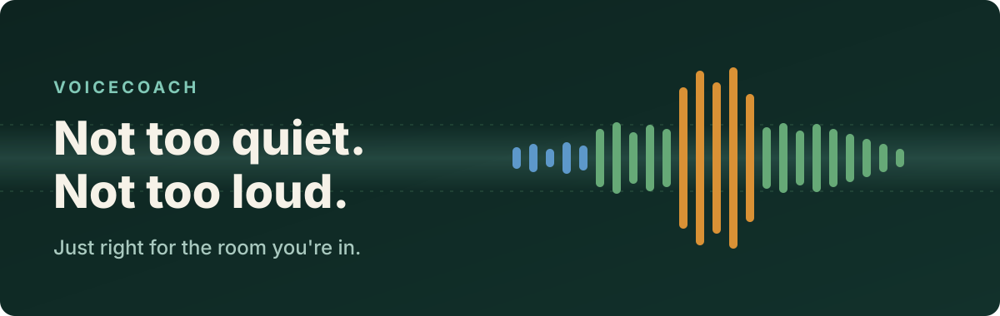
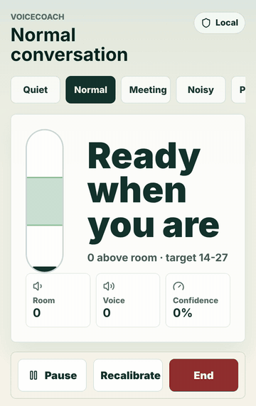
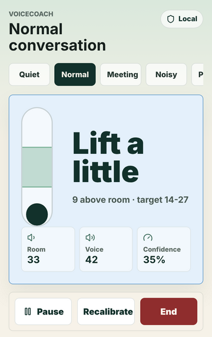
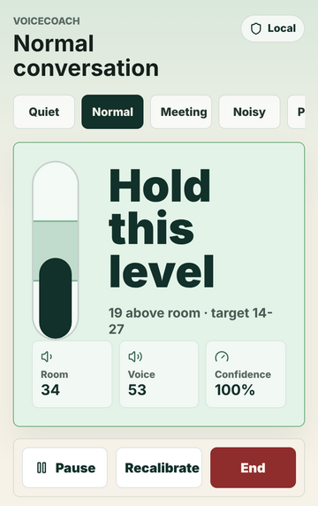
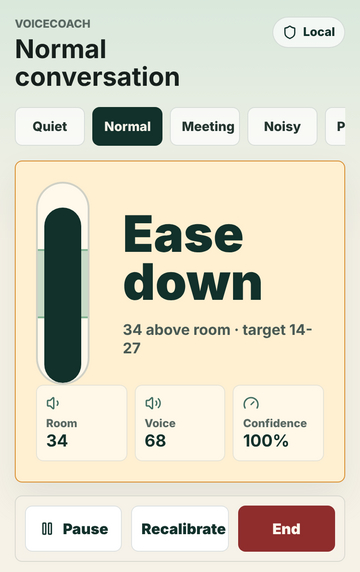
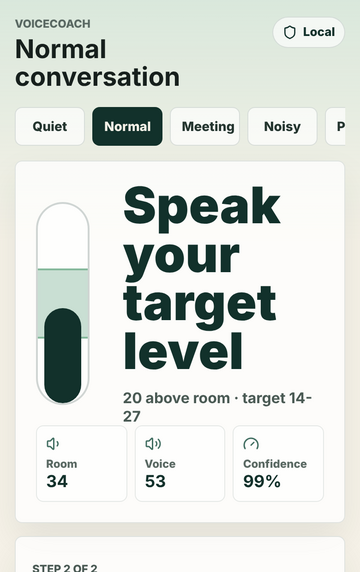
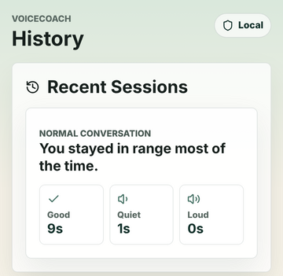

<p align="center">
  
</p>

<p align="center">
  <a href="https://voicecoach-volume.netlify.app"><strong>▶ Open the live app</strong></a>
  &nbsp;·&nbsp; phone-first PWA &nbsp;·&nbsp; 100% on-device &nbsp;·&nbsp; MIT
</p>

---

## You can't hear yourself the way they do

Your own voice reaches you through your skull as well as through the air, so you're always the worst judge of how loud you are.

You say something at what feels like a normal volume. Someone leans in and says *"sorry?"* Five minutes later, in a quiet café, you get a look from two tables over: you've been booming and didn't notice.

**VoiceCoach is a small mirror for your voice.** Prop your phone up, pick the room you're in, and talk. It listens to the room, listens to you, and gives you one calm cue:

<p align="center">
  
</p>

> **Lift a little.** &nbsp; **Hold this level.** &nbsp; **Ease down.**

That's the whole idea. There are no decibel tables and no lecture, and nothing gets uploaded. You get a gentle nudge toward "audible, but not awkwardly loud", repeated until you've learned how it feels.

---

## The three moods

<table>
  <tr>
    <td align="center"><br /><b>Lift a little</b><br /><sub>blue: they're leaning in</sub></td>
    <td align="center"><br /><b>Hold this level</b><br /><sub>green: right where the room wants you</sub></td>
    <td align="center"><br /><b>Ease down</b><br /><sub>amber: the next table can hear you too</sub></td>
  </tr>
</table>

The pill meter on the left shows where you are. The green band is the target zone for the situation you picked. Keep the dark fill inside it.

---

## What's inside

| | |
|---|---|
| 🎚️ **Situation modes** | Quiet room, normal conversation, meeting, noisy restaurant, presentation, or your own custom target. Each one sets how far above the room's background noise your voice should sit. |
| 🎙️ **Two-step calibration** | First it measures the room's background noise (~5 s of silence). Then you speak at the level you *want* to sound like, and VoiceCoach shifts the target band to fit your voice. |
| 🧭 **Live coaching** | Real-time cues with hysteresis, so a pause between words or a cough doesn't make the screen flicker. |
| 📳 **Vibration nudges** | Optional haptics: one pulse for "lift", three for "ease down". You can coach yourself mid-conversation without looking. |
| 🕶️ **Discreet mode** | Hides the numbers and keeps a big colour field you can read from the corner of your eye. |
| 🎯 **Target-feel drill** | Read a sentence with feedback on, then hide it and try to hold the same level from memory. This is the step where the level starts to stick. |
| 📊 **Session history** | Each session saves a summary of time in range, too quiet, and too loud, plus one suggestion for next time. |
| 🔒 **Local-only** | Audio is analysed in the browser and never recorded or uploaded. History lives in `localStorage` and you can delete it. |

<p align="center">
  
  &nbsp;&nbsp;
  
</p>

---

## A short history of speaking up

People have been studying this problem for over a century, and it turns out to be stranger than it looks.

**1909: Étienne Lombard notices something odd.** The French ear doctor found that when you play noise into someone's ears, they start talking louder, without deciding to and usually without noticing. He used it to catch people faking deafness: a person who claimed to be deaf but raised their voice when the noise came on could clearly hear it. This is now called the **Lombard effect**, and it's one of the most dependable reflexes in human speech. It isn't only human, either. Nightingales in Berlin sing louder on weekday mornings when the traffic is heavier, and whales, bats and monkeys show versions of it too.

**1920s: the decibel is invented.** Bell Telephone engineers needed a unit for how much signal a phone line lost over distance. They chose a logarithmic scale that matches how ears actually work and named it the *bel*, after Alexander Graham Bell. A tenth of a bel, the **decibel**, became the unit everyone uses. VoiceCoach works the same way: it measures how many dB your voice sits *above the room*, not some absolute loudness.

**Sidetone: the telephone's quiet trick.** Early phone engineers found that when callers couldn't hear their own voice in the earpiece, they shouted. So phones were designed to feed a little of your voice back to you, called **sidetone**, to keep people at a comfortable level. A century before smartphones, engineers were already giving people feedback about their own voice. VoiceCoach does the same job with a screen instead of an earpiece.

**1950s: the cocktail party problem.** In 1953 Colin Cherry asked how we follow a single voice in a noisy room. Around the same time, researchers found that delaying a speaker's own voice in their headphones by a fraction of a second could make fluent speakers stumble. Together these showed that **speaking is a feedback loop** between your mouth and your ears, and the loop can be miscalibrated.

**1987: recalibrating "normal".** Lorraine Ramig developed the Lee Silverman Voice Treatment (LSVT LOUD), named after a woman with Parkinson's disease whose voice had faded to a whisper. Its key insight was that people with hypophonia weren't choosing to speak quietly. Their internal sense of *what normal sounds like* had drifted, so that speaking at a healthy volume *felt* like shouting to them. The therapy works by recalibrating that sense through intensive practice against an external reference.

**Now: a mirror in your pocket.** Every phone has a good microphone and a browser that can analyse audio in real time with the Web Audio API. VoiceCoach borrows from all of the above: Lombard's insight that the right volume depends on the room, the decibel's relative scale, the sidetone idea of feedback, and LSVT's lesson that **feeling** the right level is what you're trying to learn. A meter alone doesn't do that.

> VoiceCoach is not therapy and doesn't claim to be. It takes one research idea, *practise against an external reference until it becomes internal*, and puts it in an app anyone can use. The detailed research notes and sources are in [PLAN.md](./PLAN.md).

---

## How it hears you

```
 mic ──▶ Web Audio AnalyserNode ──▶ RMS of float samples ──▶ relative dB
                                                         │
                     ┌───────────────────────────────────┤
                     ▼                                   ▼
          room level (noise floor)              voice level (smoothed)
          · seeded during a short warm-up       · follows you while you speak
          · adapts in pauses between words      · decays gently in silence
                     └──────────────┬────────────────────┘
                                    ▼
                     voice − room  vs  situation target band
                                    ▼
                lift a little · hold this level · ease down
```

- **Relative, not absolute.** Phone mics aren't calibrated sound-level meters, so VoiceCoach never claims "you're at 62 dB SPL". It only tracks how far your voice sits above the background noise, which is also what listeners notice.
- **Room-aware.** The noise floor is measured continuously, so moving from a quiet office to a busy café updates your target automatically. In effect the app accounts for the Lombard effect for you.
- **Forgiving.** Natural pauses between words hold the last cue rather than flashing "uncertain".

---

## Quick start

```bash
npm install
npm run dev      # http://localhost:5173 (use HTTPS or localhost for mic access)
npm run build    # type-check + production bundle in dist/
npm run lint
```

Microphone access requires a **secure context**. The Netlify deployment uses HTTPS. To test on a phone locally, use an HTTPS tunnel. The main test device is a mid-range Android phone (Pixel 7a); desktop is fine for layout checks, but the real test is a phone propped on a table during an actual conversation.

**Stack:** React 19 · TypeScript · Vite · Web Audio API · Service-worker PWA · Netlify ([`netlify.toml`](./netlify.toml))

---

## Privacy

- 🎙️ Audio is analysed in real time, in the browser, and then discarded.
- 🚫 Nothing is recorded or uploaded.
- 💾 Settings, calibrations and session summaries stay in this browser's local storage.
- 🗑️ **Settings → Delete history** wipes it.

## Status

This is an early working prototype. Areas that still need real-world tuning:

- Microphone behaviour on different phones and in different positions (handheld, table, chest, pocket)
- Thresholds for quiet rooms versus noisy rooms
- Voice-activity detection edge cases (music, TV, other people talking)
- Comfort and timing of alerts in long sessions

## Safety scope

VoiceCoach is a coaching and self-awareness tool. It does **not** diagnose or treat autism, Parkinson's disease, hearing loss, anxiety, or speech disorders. If you notice persistent voice changes, pain, sudden speech changes, trouble swallowing, or neurological symptoms, please talk to a qualified clinician.

## License

[MIT](./LICENSE)

<p align="center"><sub>Speak so the room can hear you, and no louder.</sub></p>
